# PROJECT GENESIS: Autonomous AI Society Simulation

> **"Interactive Simulacra of Human Behavior" — Multi-Agent Generative Society Engine**  
> Inspired by Stanford University & Google Research (*Park et al., 2023*).

---

## 1. Overview & Vision

**PROJECT GENESIS** is an autonomous artificial society simulation where **25 independent AI-driven inhabitants** live in a continuous, persistent virtual town. 

Unlike traditional game NPCs that follow rigid finite-state machines or pre-scripted dialogue trees, Genesis agents possess:
- **Persistent Personal Identities**: Name, age, profession, Big Five personality traits, life backstories, beliefs, core values, and life goals.
- **Three-Tier Memory Architecture**: Short-term memories, permanent long-term experiences, and synthesized reflective beliefs.
- **Epistemic Observational Boundaries**: NPCs do not have global omniscient knowledge; they only know what they physically observe in their location or learn through conversations with other inhabitants.
- **Hierarchical Daily Planning & Reactive Replanning**: Structured daily routines decomposed into dynamic blocks, with automatic revision when unexpected events occur.
- **Dynamic Needs & Emotions**: Continuous decay and satisfaction of vital needs (Energy, Hunger, Social, Fun, Hygiene, Purpose) coupled with a 9-state emotional engine (Happy, Sad, Angry, Curious, Excited, Afraid, Lonely, Relaxed, Frustrated).
- **Emergent Social Relationships**: Continuous tracking of Familiarity, Trust, Affinity, Respect, and Conflict among all 25 agents, evolving naturally from autonomous conversations.
- **Controlled Action Registry**: Strict verification of all agent decisions against the simulation engine to prevent hallucinated or physically invalid actions.

---

## 2. System Architecture

```mermaid
graph TD
    subgraph Frontend["Frontend Dashboard (React 19 + TypeScript + Vite + Tailwind + Canvas)"]
        UI_WorldView["2D Canvas Town Map (Interactive, Day/Night, Weather, Pathing)"]
        UI_NPCProfile["NPC Profile & Biological/Psychological Inspector"]
        UI_MemoryViewer["Memory Stream & Reflection Hierarchy (Semantic Retrieval)"]
        UI_SocialGraph["Social Network & Relationship Graph (@xyflow/react)"]
        UI_Timeline["Chronological World Timeline & Emergent Feed"]
        UI_GodMode["God Mode Event Injector (Preset & Custom Scenarios)"]
    end

    subgraph Backend["Backend Engine (Python 3.12 + FastAPI + Asyncio + SQLAlchemy)"]
        WS_Server["WebSocket Manager & REST API Engine"]
        
        subgraph SimEngine["World Simulation Engine"]
            Clock["Simulation Clock (Ticks, Hours, Day/Night, Speed 1x-10x)"]
            Weather["Weather Engine (Sunny, Rain, Storm, Comfort)"]
            TownGrid["Grid & Navigation Engine (A* Pathfinding & Waypoints)"]
            ActionReg["Controlled Action Registry & Simulation Rule Validator"]
            EventBus["Centralized Epistemic Event Bus (History + Observation Radius)"]
            Engine["Simulation Coordinator Loop"]
        end

        subgraph AgentSubsystems["NPC Intelligence Architecture (25 Agents)"]
            Agent_Identity["Persistent Identity (Bio, Big Five, Goals, Roles)"]
            Agent_Needs["Dynamic Needs System (Energy, Hunger, Social, Fun, Purpose)"]
            Agent_Emotions["Emotional State Machine (Valence, Arousal, Intensity)"]
            Agent_Memory["Memory Subsystem (Short, Long, Stanford 3-Factor Retrieval)"]
            Agent_Reflection["Reflection Engine (Memory Summaries & Higher-Level Belief Updates)"]
            Agent_Planning["Hierarchical Daily Planner (Broad Strokes to Dynamic 15-min Blocks)"]
            Agent_Decisions["Decision Engine (Deterministic Rules + Structured AI Action Selection)"]
            Agent_Social["Social & Conversation Engine (Turn-taking, Rumor Spreading)"]
        end

        subgraph AIAbstraction["AI Reasoning Provider Layer"]
            Provider_Interface["Base LLMProvider (Async, Structured Pydantic)"]
            Mock_Provider["Deterministic Mock Provider (Offline, Fast Tests, Zero-Cost)"]
            Gemini_Provider["Google Gemini API Provider (gemini-2.5-flash)"]
            Embedding_Engine["Local Dense Vector Embeddings (128-dim Cosine Similarity)"]
        end

        subgraph Persistence["Storage & Persistence"]
            DB_SQLite["SQLite DB (SQLAlchemy Async ORM)"]
            Checkpoints["World State Checkpoints (Save & Restore)"]
        end
    end

    Frontend <-->|WebSocket Stream /ws/simulation| WS_Server
    WS_Server --> SimEngine
    SimEngine --> AgentSubsystems
    AgentSubsystems --> AIAbstraction
    AgentSubsystems <--> Persistence
    SimEngine <--> Persistence
```



---

## 3. Stanford Generative Agents Memory & Reflection Formula

Following Park et al. (2023), each memory retrieval query scores past experiences using three weighted components:

$$\text{Score}(m) = \alpha_{\text{recency}} \cdot \text{Recency}(m) + \alpha_{\text{importance}} \cdot \text{Importance}(m) + \alpha_{\text{relevance}} \cdot \text{Relevance}(m, q)$$

- **Recency**: Exponential decay over simulated hours: $\text{Recency}(m) = \gamma^{t - t_m}$ ($\gamma = 0.995$).
- **Importance**: Scored on memory formation from $1.0$ (mundane routine) to $10.0$ (life-altering event). Memories with importance $\ge 8.0$ are promoted to long-term memory.
- **Relevance**: Cosine similarity between the normalized 128-dimensional query vector and the memory embedding.
- **Reflection Trigger**: When cumulative memory importance exceeds the threshold ($\ge 25.0$) or during evening wind-down (21:00), the reflection engine retrieves salient memories, synthesizes high-level insights, updates the NPC's beliefs, and stores new reflection memories.

---

## 4. The 25 Autonomous Inhabitants

| # | Name | Age | Occupation | Big Five Trait Highlight | Home / Workplace | Primary Life Objective |
|---|------|-----|------------|--------------------------|------------------|------------------------|
| 1 | **Arthur Vance** | 54 | Town Mayor | High Conscientiousness (0.90) | Vance Manor / Town Hall | Organize Autumn Heritage Festival |
| 2 | **Clara Bennett** | 32 | Master Baker | High Extraversion (0.90) & Agreeableness | Bennett Cottage / Bakery | Bake award-winning honey loaf |
| 3 | **Dr. Marcus Thorne** | 45 | Town Physician | High Conscientiousness (0.95) & Introvert | Thorne Residence / Clinic | Document local medicinal flora |
| 4 | **Elena Rostova** | 28 | Investigative Chronicler | High Openness (0.95) & Curiosity | Rostova Studio / Library | Uncover town founding family history |
| 5 | **Lucas Gray** | 24 | Apprentice Carpenter | High Openness & Energy | Shared Flat / Workshop | Build Oakridge Park gazebo |
| 6 | **Sarah Jenkins** | 38 | Town Librarian | High Conscientiousness (0.90) & Serene | Jenkins House / Library | Digitize centuries of council ledgers |
| 7 | **David Miller** | 42 | Blacksmith & Metalcrafter | High Conscientiousness (0.90) & Stoic | Miller Lodging / Workshop | Craft resilient plowshares for farms |
| 8 | **Sophie Lin** | 22 | Florist & Botanist | High Openness (0.85) & Agreeableness | Greenhouse House / Market | Decorate Town Square with sunflowers |
| 9 | **Victor Vance** | 26 | Commerce Coordinator | High Ambition & Conscientiousness | Vance Manor / Market | Establish regional trade routes |
| 10 | **Beatrice Ward** | 65 | Retired Headmistress | Universal Trust & High Wisdom | Ward Sanctuary / Community Hall | Host historical town archive exhibition |
| 11 | **Julian Cole** | 31 | Tavern Host & Balladeer | High Extraversion (0.95) & Charisma | Innovator Lodge / Tavern | Host open-mic music and cider nights |
| 12 | **Hannah Abbott** | 29 | Organic Farm Manager | High Conscientiousness & Early Riser | Farmstead / Farmstead | Supply organic produce to all town shops |
| 13 | **Liam O'Connor** | 35 | Town Safety Coordinator | High Protection & Vigilance | Miller Lodging / Town Hall | Inspect safety of chimney hearths |
| 14 | **Chloe Martin** | 21 | Art Student & Muralist | High Openness (0.95) & Creative | Jenkins House / Park | Paint community mural on Town Hall |
| 15 | **Oliver Wright** | 48 | Master Horologist | High Precision & Eccentric Detail | Clock Loft / Workshop | Restore Town Hall four-faced clock chime |
| 16 | **Maya Patel** | 34 | Clinical Pharmacist | High Empathy & Conscientiousness | Patel Quarters / Clinic | Formulate soothing organic balms |
| 17 | **Henry Fletcher** | 60 | Master Timber Craftsman | Traditional Joinery & Master Builder | Shared Flat / Workshop | Complete community hall roof trusses |
| 18 | **Zoe Zhao** | 27 | Information Architect | High Openness & System Analyst | Innovator Lodge / Library | Deploy town digital resource directory |
| 19 | **Samuel Reed** | 50 | General Storekeeper | High Conscientiousness & Shrewd | Miller Lodging / General Store | Stock town winter dry goods |
| 20 | **Isabella Rossi** | 36 | Executive Chef | High Passion & Perfectionist | Greenhouse House / Bistro | Craft 5-course local tasting menu |
| 21 | **Noah Brooks** | 23 | Park Ranger | High Stewardship & Quiet Nature | Shared Flat / Park | Build birdhouses along park trails |
| 22 | **Grace Cooper** | 40 | Master Tailor | High Care & Fine Needlework | Clock Loft / General Store | Weave festival banners for town square |
| 23 | **Felix Kim** | 30 | Express Courier | High Extraversion (0.90) & Speed | Innovator Lodge / Town Square | Zero delivery delays across town |
| 24 | **Nora Rivera** | 43 | Elementary School Teacher | High Inspiration & Event Organizer | Patel Quarters / Community Hall | Coordinate Children's Discovery Day |
| 25 | **Ethan Vance** | 19 | Philosophy Student | High Openness (0.95) & Moral Thinker | Vance Manor / Library | Write philosophical essay on ethics |

---

## 5. Automated Validation & Test Suite

The simulation is verified with an automated test suite passing all **12 core scenario requirements**:

| Test ID | Scenario Tested | Status |
|:---:|:---|:---:|
| 1 | **NPC remembers another NPC after a conversation** | ✅ PASSED |
| 2 | **NPC retrieves a relevant past memory (3-factor scoring)** | ✅ PASSED |
| 3 | **NPC changes its plan when an unexpected event occurs** | ✅ PASSED |
| 4 | **NPC relationship changes after meaningful interactions** | ✅ PASSED |
| 5 | **NPC can independently initiate a conversation** | ✅ PASSED |
| 6 | **NPC can develop and prioritize a new goal** | ✅ PASSED |
| 7 | **NPC can complete a planned activity and satisfy needs** | ✅ PASSED |
| 8 | **NPC retains identity & memories across restart (SQLite persistence)** | ✅ PASSED |
| 9 | **World simulation continues deterministically without LLM requests** | ✅ PASSED |
| 10 | **Invalid AI-generated actions are rejected by Action Registry** | ✅ PASSED |
| 11 | **NPCs cannot access information they have not observed or heard** | ✅ PASSED |
| 12 | **Simulation can be paused, resumed, and stepped safely** | ✅ PASSED |
| 13 | **REST API World State & Map Endpoints** | ✅ PASSED |
| 14 | **REST API NPC Profiles, Memories & Social Graph** | ✅ PASSED |
| 15 | **REST API Simulation Controls & God Mode Injection** | ✅ PASSED |

Run the test suite anytime:
```powershell
$env:PYTHONPATH="backend"
.\.venv\Scripts\pytest backend\tests -v
```

---

## 6. Getting Started

### Prerequisites
- Python 3.12+
- Node.js v18+ and npm

### Installation
1. Activate virtual environment and install backend requirements:
   ```powershell
   python -m venv .venv
   .\.venv\Scripts\pip install -r backend\requirements.txt
   ```

2. Install frontend dependencies:
   ```powershell
   cd frontend
   npm install
   cd ..
   ```

3. Configure Environment Variables (Optional):
   ```powershell
   cp .env.example .env
   ```
   *By default, `AI_PROVIDER=mock` is enabled for zero-cost, high-speed, 100% deterministic local execution. To use Google Gemini, set `AI_PROVIDER=gemini` and provide `GEMINI_API_KEY`.*

### Running the Application

Option A — **Quick-Launch Script**:
```powershell
.\start.ps1
```

Option B — **Manual Launch**:
1. Terminal 1 (Backend Engine):
   ```powershell
   $env:PYTHONPATH="backend"
   .\.venv\Scripts\python run_simulation.py
   ```
   *FastAPI server runs on `http://localhost:8000` (API documentation at `http://localhost:8000/docs`).*

2. Terminal 2 (Frontend Dashboard):
   ```powershell
   cd frontend
   npm run dev
   ```
   *Vite development server runs on `http://localhost:5173`.*

---

## 7. Extensibility for Unreal Engine 5 Client

The backend architecture is strictly decoupled from the visualization client:
- The `/ws/simulation` WebSocket stream broadcasts complete, standardized coordinate and state packets (`x`, `y`, `heading`, `current_activity`, `emotion`, `speech_bubble`, `location_id`).
- An Unreal Engine 5 client using the official `WebSocket` plugin or C++ socket client can connect directly to `ws://localhost:8000/ws/simulation`, parse the JSON tick stream, and animate 3D Skeletal Meshes with Metahumans in real-time.
